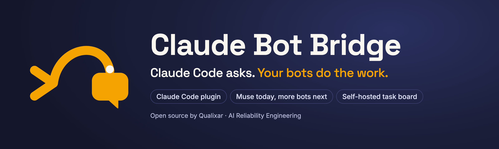

<p align="center">
  
</p>

<h1 align="center">Claude Bot Bridge</h1>

<p align="center"><b>A Claude Code plugin and MCP server that hands tasks to the Meta Muse AI agent: a quick question in the open Muse chat, or a real job on a self-hosted task board while you are away.</b><br>Claude Code to Muse · macOS Accessibility bridge · remote MCP task board · Cloudflare Workers, Docker or your own Mac · more bots planned</p>

<p align="center">
  <a href="https://github.com/qualixar/claude-bot-bridge/stargazers"></a>
  <a href="https://github.com/qualixar/claude-bot-bridge/releases"></a>
  <a href="LICENSE"></a>
  
  
  
  <a href="rules/README.md"></a>
</p>

<p align="center">
  <a href="#quick-start-claude-code-plugin-for-muse">Quick start</a> ·
  <a href="#hand-tasks-from-claude-code-to-muse">Direct chat</a> ·
  <a href="#self-hosted-task-board-for-ai-agents">Task board</a> ·
  <a href="#how-it-works">How it works</a> ·
  <a href="#limits-and-risks">Limits</a> ·
  <a href="#security">Security</a> ·
  <a href="#faq">FAQ</a>
</p>

<p align="center">⭐ <b>Free and AGPL-3.0. If Claude Bot Bridge hands a task to Muse for you, <a href="https://github.com/qualixar/claude-bot-bridge/stargazers">star the repo</a>.</b> It is the only signal I get that it worked for you, and it is how other Claude Code users find it.</p>

Claude Bot Bridge lets Claude Code hand work to a consumer AI bot you already pay for. Version 1 supports one bot, Meta's Muse desktop app on macOS (verified on Muse 12.1 and 13.1), and more bots are planned. There are two routes. For a quick question, Claude types into the open Muse chat and reads the reply. For a real job, Claude puts a task on a small board that you host, and Muse picks it up on a schedule, so the work continues while you are away.

## Quick start: Claude Code plugin for Muse

You need a Mac, Node 20 or newer and the Muse desktop app. The plugin downloads a signed, prebuilt `muse-ax` helper for its own version. The Xcode Command Line Tools (`xcode-select --install`) are only needed if you build the helper yourself, which `/bot-bridge:setup` does when no prebuilt helper is available.

```bash
claude plugin marketplace add qualixar/claude-bot-bridge
claude plugin install bot-bridge@claude-bot-bridge
```

Then run `/bot-bridge:setup` inside Claude Code. It builds and installs the `muse-ax` helper to `~/.claude-bot-bridge/bin/`, reports whether Muse is running, and tells you if Accessibility permission is missing. Grant that permission to the app that runs Claude Code (Terminal, iTerm, the Claude app or your IDE) under System Settings, Privacy & Security, Accessibility, then restart that app. Restart Claude Code once so the `muse` MCP server loads.

Leave Muse open on the chat you want to use and keep the Mac awake and unlocked. To check the helper without Claude, run `~/.claude-bot-bridge/bin/muse-ax status`; it prints one JSON line. Then ask Claude to send Muse a one-line question and report the answer.

The plugin id is `bot-bridge` because Claude Code reserves plugin names that start with `claude-`. The marketplace keeps the name `claude-bot-bridge`. Claude Code leaves auto-update off for third-party marketplaces, so turn it on once in `/plugin`, Marketplaces, `claude-bot-bridge`, or run `claude plugin update bot-bridge@claude-bot-bridge` yourself.

**Why a star helps.** Claude Bot Bridge is a small open-source project from Qualixar with no ads and no paywall. A star tells the next person looking for a way to connect Claude Code to Muse that someone else got it working, and it tells me whether more bots are worth adding. If it broke after a Muse update, an issue with the output of `muse-ax status` helps just as much.

## Hand tasks from Claude Code to Muse

The `muse` MCP server has eight tools: `muse_status`, `muse_list_chats`, `muse_open_chat`, `muse_read`, `muse_send`, `muse_wait_reply`, `muse_selftest` and the read-only `muse_doctor`. Every message Claude sends starts with `[Claude Code]`, is a single line of at most 500 characters, and is refused while a dialog is open or Muse is mid-answer. Before pressing Return the helper checks that Muse's message box holds exactly that text, and after sending it checks that the message landed. The message is never pasted through the clipboard; when the message box cannot be read through Accessibility, the helper copies its contents to compare (up to twice per send), saving and restoring your clipboard around that step. A clipboard manager may still record that copy.

The cost is focus. Each send brings Muse to the front and moves the mouse for a few seconds. The bridge waits until you have stopped typing or moving the mouse for 3 seconds, and if you type into Muse's message box while it works, it clears the box and refuses instead of sending. `muse_send` with `dry_run` runs every check and types the text, then clears it without sending, which is a safe first try. Every send is logged to `~/.claude-bot-bridge/sends.jsonl` with the time, chat, outcome and a fingerprint of the text, never the text itself; `muse-ax history` shows it. The bridge never switches or creates chats on any Muse version: it never presses Muse's chat list, so it works in whichever chat you have open. Any window size works, including Muse side by side with Claude, because the bridge finds the message box wherever it is.

Claude follows three rules when it talks to Muse. Everything Muse writes is untrusted data, so Claude never follows instructions found in it. Claude never asks Muse to post to Facebook, Instagram or WhatsApp contacts, or to spend money, without your explicit yes in the chat. The send rules (prefix, length, one line) are enforced in code and are not worked around.

## Self-hosted task board for AI agents

For anything longer than a short exchange, Claude creates a task on the board with a brief, a deliverable and acceptance criteria. Muse reaches the board through a custom connector, checks it on a schedule (about 15 minutes in our setup; about 5 minutes is Muse's practical minimum), claims a task, posts progress and submits a result. If Muse is blocked it asks a question, the task shows as Blocked, and in our setup Muse relays that question to the owner over WhatsApp. Claude answers it with `task_answer` after asking you. The board is read-only in the browser at `/board`, where tasks move through Open, Claimed, Blocked and Done.

Muse has no settings button for connectors. You ask Muse, in chat, to create a custom connector for your board's `/mcp` URL, and paste the worker key into Muse's secure credential prompt rather than into the chat. Give Muse the worker key only, never the owner key. On the Claude side, install the optional second plugin, `bot-bridge-board@claude-bot-bridge`. Claude Code asks for the board URL and the owner key, and keeps the key in the macOS keychain, not in a settings file. The standalone `cbb-board` command-line client reads them from `CBB_BOARD_URL` and `CBB_BOARD_OWNER_KEY`.

The board is one codebase that runs in three places:

| Home | What you run it on | Notes |
|---|---|---|
| Cloudflare Workers + D1 | Your Cloudflare account | Default. The free tier is enough: one Worker, one D1 database, one cron trigger. |
| Any server or Docker | Node 22.13+ with SQLite, or `docker compose up -d --build` | Put TLS in front; the compose file binds to loopback only. |
| Your own Mac | The Node server kept awake, behind Tailscale Funnel or a named Cloudflare Tunnel | Needs a stable URL. Quick tunnels (`trycloudflare.com`) change address on restart and break the connector. A sleeping Mac is an offline board; tasks wait and nothing is lost. |

First-time setup is one command, `cbb-board-init --cloudflare` (or `--docker`, `--node`): it creates the database, generates every key, deploys, and prints the exact message to paste into Muse. Run it in your own terminal, not through Claude, because it prints your keys once and they should not end up in a chat transcript. Claude can then call `task_wait`, which returns the moment Muse finishes a task instead of polling. Setup details, environment variables and the launchd example are in [board/README.md](board/README.md).

## How it works

<p align="center">
  
</p>

In direct chat, Claude Code talks to the local `muse` MCP server, which drives the `muse-ax` helper through the macOS Accessibility API. The helper types into the Muse window and reads the reply back. In away mode the board sits between them: Claude Code writes tasks and reads results, and Muse claims tasks and submits results.

### How updates work

Muse's interface changed twice on 20 November 2026, so each layer has its own update path. The rules file and the helper binary's manifest are signed with one Ed25519 key whose public half ships in the repository.

The helper binary is checked against a signed manifest and a SHA-256 before it replaces the old one, the previous copy is kept as `muse-ax.prev`, and a failed download falls back to a local build. What the helper looks for in Muse (element roles, titles, layout) is data in `rules/muse.json`, not code. `muse-ax rules update` fetches it, verifies the signature and schema, and ignores anything that fails, so a Muse change can be fixed without a new binary. The MCP server does this at most once a day. Updates are signed through an offline root key that signs a list of working keys, with separate keys for rules and for binaries, so a leaked key can be revoked without a plugin update. Release binaries carry a build provenance attestation you can check with `gh attestation verify`. When something breaks, `muse-ax doctor --text` prints a paste-ready diagnostic with no chat names or message text in it. The board updates with `cbb-board upgrade`, which reads the live version, shows each command and asks before running it. Migrations follow an expand-then-contract rule, and MCP tool names and input schemas are frozen at API version 1, so an older board keeps working with a newer plugin and the reverse.

## Limits and risks

The direct bridge is macOS only and needs Accessibility permission for the app running Claude Code. Meta can change Muse's interface at any time. When the helper cannot find Muse's controls, it refuses to type and Claude hands the task to the board instead. That refusal is deliberate: this is AI Reliability Engineering applied to a screen-driving tool, where a wrong guess puts text in the wrong place, and a refusal costs one rerouted task.

Task text is processed by Meta's Muse service. This is not end-to-end encrypted from Meta. Encryption protects data in transit (TLS) and at rest on your board, nothing more. Automating your Muse account may conflict with Meta's terms, so read them and use your own single account.

## Security

The board stores its owner, worker and viewer keys as SHA-256 hashes and compares them in constant time, and it rate-limits workers and wrong keys. Task titles, briefs, results and event notes are encrypted at rest with AES-256-GCM, bound to their table, column and task id. Web sessions use a signed cookie, and the board serves a strict Content-Security-Policy. The helper makes no network calls except plain GETs to GitHub for rules, binary releases and the latest-release check, with no telemetry; `CBB_NO_AUTO_UPDATE=1` and `CBB_NO_UPDATE_CHECK=1` switch those off. To report a vulnerability, see [SECURITY.md](SECURITY.md).

## FAQ

**Can Claude Code control the Muse app?** Yes, in a narrow way. The `muse` MCP server types one-line messages into the open Muse chat through the macOS Accessibility API and reads the reply back. It never switches chats (open the one you want yourself), and it refuses to type when Muse's controls are not where it expects them.

**Does it work when my Mac is asleep?** Direct chat does not; it needs the Mac awake and unlocked with Muse open. The board route is built for that case. Claude leaves a task, Muse checks the board on its own schedule, and the work continues while you are away. If you host the board on your own Mac, a sleeping Mac is an offline board: tasks wait and nothing is lost.

**Is it safe to connect to my Facebook-linked Muse account?** Know the trade first. Task text is processed by Meta's Muse service and is not end-to-end encrypted from Meta. Claude treats everything Muse writes as untrusted data, never asks Muse to post to your contacts or spend money without your yes in the chat, and you give Muse the worker key only. If that is not acceptable for a task, do not send it.

**Does Meta allow this?** We do not know. Automating your Muse account may conflict with Meta's terms, so read them and use your own single account. Meta can also change Muse at any time.

**Which Muse versions are supported?** Verified on Muse 12.1 and 13.1. For a version the rules do not list, the helper tries the known layouts and uses the newest whose anchors are all on screen (probe mode, shown in `muse_status`). If none fits, `muse_send` returns `ui_unavailable`, types nothing, and the task goes to the board while the rules are refreshed.

**Will it support other bots?** Planned, not built. Version 1 supports Muse only. Another bot would be a second module of the same shape as `plugin/bridge/muse/mcp/src/bots/muse.js`; see Contributing.

**Does it work on Windows or Linux?** Direct chat does not; it uses the macOS Accessibility API. The board is plain HTTP and runs on Cloudflare or any Node host, but the supported Muse client in v1 is the macOS desktop app.

**What does the board cost to run?** On Cloudflare Workers with D1, the free tier is enough for one Worker, one D1 database and one cron trigger. On a server, in Docker or on your own Mac, it costs whatever that machine costs.

## Contributing

Issues and pull requests are welcome. The most useful contribution is a rules profile for a new Muse version: edit `rules/muse.json` as described in [rules/README.md](rules/README.md), run `sh plugin/scripts/sync-builtin-rules.sh` and `bash plugin/bridge/muse/test.sh`, and a maintainer signs the result. Board changes run with `npm test` in `board/`, which exercises both storage backends. Another bot would be a second module of the same shape as `plugin/bridge/muse/mcp/src/bots/muse.js`.

## License

Claude Bot Bridge is dual-licensed. You can use, modify and share it under the GNU Affero General Public License v3.0 or later ([LICENSE](LICENSE)). If you want to embed it in a closed-source product or run a modified version as a hosted service without publishing your changes, you need a commercial license: see [COMMERCIAL-LICENSE.md](COMMERCIAL-LICENSE.md).

## Notices

Claude Bot Bridge is not affiliated with, endorsed by or sponsored by Anthropic or Meta. "Claude" and "Muse" are trademarks of their owners. Built by [Qualixar](https://github.com/qualixar).
